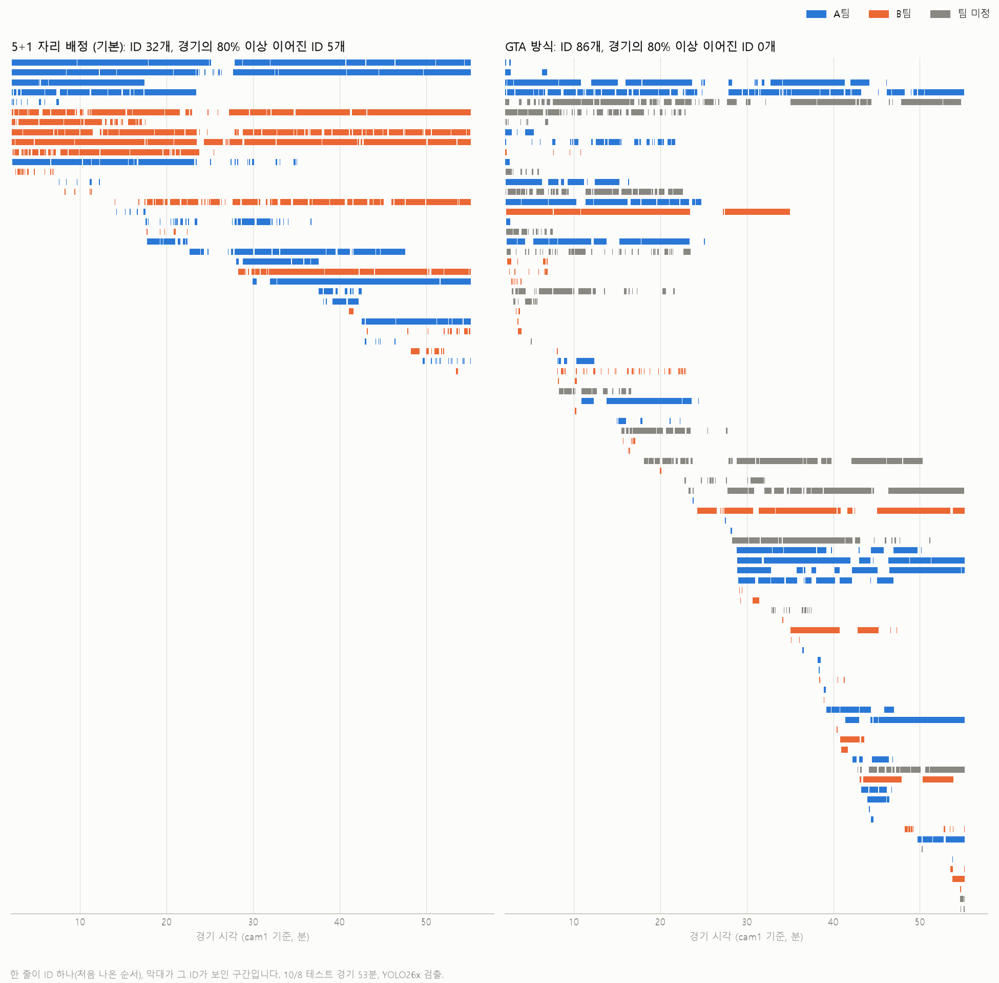

# 추적 v2: 방법, 결과, 알게 된 것

10/8 테스트 경기(두 폰, 53분 겹침)로 만든 선수 추적·ID 방식입니다. 코드는 `src/futsal/pipeline/`, 실험 코드는 `experiments/`에 있습니다.

**한 줄 요약:** 카메라마다 **확실한 짧은 조각**만 만들고, 두 카메라의 같은 선수 조각을 짝지은 뒤, **팀당 5+1 자리**에 배정합니다. 기성 추적기 6종이 6분 구간에서 ID를 124~657개로 쪼갠 데 비해, v2는 12개(실제 10명 + 교체·골키퍼)로 줄였습니다. 53분 경기 전체에서는 ID 32개 중 5명이 경기의 80% 이상 같은 ID로 이어집니다 (YOLO11 박스로는 ID 25개, 6명).

## 1. 단계

비전 3단계(탐지 → 추적 → 위치 추정·분석) 중 **추적** 부분입니다. 실제 순서는 좌표 변환을 먼저 합니다. 두 카메라를 경기장 좌표에서 합쳐야 ID를 붙일 수 있기 때문입니다.

| # | 단계 | 하는 일 | 기술 | 코드 |
|---|---|---|---|---|
| 1 | 탐지 | 사람 박스 (신뢰도 0.1 이상, 초당 10장) | YOLO26x, 1280px | `detect.py` |
| 2 | 외형 특징 | 박스마다 512차원 특징 + 상체·하체 색 분포 | OSNet-AIN (boxmot) | `reid.py` |
| 3 | 좌표 변환 | 발 위치 픽셀 → 경기장 미터. 카메라가 밀린 시점부터는 다른 보정값 | 호모그래피 + 보정 타임라인 | `boxes.py` |
| 4 | 시간 격자 | 두 카메라를 같은 10Hz 격자에. 한 칸에 원본 프레임 하나 | 소리로 맞춘 시간 차 | `boxes.grid_frames` |
| 5 | 팀 분류 | 카메라마다 상체 색 2그룹, 두 카메라 그룹은 같은 선수 짝으로 맞춤 | k-means | `boxes.assign_teams` |
| 6 | 카메라 정합 | 같은 선수 짝(가까움 + ReID 비슷 + 서로 최근접)으로 3차 보정면을 맞추고 두 카메라를 가운데로 | 자체 | `align.align_cameras` |
| 7 | 카메라별 조각 | 박스를 키워 겹침 비교(Deep-EIoU 방식). 애매하면 바로 끊음 | 자체 (Deep-EIoU 변형) | `tracklets.conservative_tracklets` |
| 8 | 카메라 간 짝짓기 | 두 카메라 조각이 같은 사람인지 (위치 거리 + 팀 + ReID) | LMGP 아이디어 | `tracklets.pair_views` |
| 9 | 전역 ID 연결 | 조각을 팀당 5+1 자리에 배정 (정수 최적화). 경기 전체는 6분 창(1분 겹침)으로 풀고 이어 붙임 | MILP (scipy) | `link_closed.py` |
| 10 | 궤적 평활화 | 칼만 필터 앞뒤 평활화로 위치 다듬기 | RTS | `refine.py` |

**다른 연결 방식 (`--ids v2gta`):** 9번 대신 정원 없이 비슷한 조각부터 합칩니다(GTA 방식). BoostTrack 결과를 참고해 끊긴 조각을 먼저 다시 잇습니다. 코드는 `sources.py`, `link_gta.py`이고, 연구 코드 결과와 상자 단위로 같습니다.

## 2. 결과

### 기성 추적기 (6분 구간, 9:00~15:00)

ByteTrack, OC-SORT, BoT-SORT, DeepOCSORT, BoostTrack, HybridSort를 카메라별로 돌리거나 두 카메라 결과를 합쳐 돌리면 ID가 124~657개 나옵니다. 같은 조끼의 같은 팀 선수가 자주 겹치는 풋살에서는 버티지 못했습니다.

### 블라인드 눈 판정

긴 ID 하나의 장면 16장을 모아 "다른 사람이 섞였나"를 보고(순도), 같은 팀 두 선수가 엇갈린 순간 전후를 보고 "ID가 바뀌었나"를 봤습니다(뒤바뀜). 판정하는 쪽은 어느 방식의 결과인지 모르게 했습니다.

| 구간 | 방식 | ID 수 | 순도 | 엇갈림에서 뒤바뀜 |
|---|---|---|---|---|
| 9:00~15:00 (조정에 쓴 구간) | 예전 방식 | 68 | 0.89 | 55% |
| | **v2 (5+1 자리)** | 12 | 0.97~0.98 | 19~30% (7/36) |
| | v2gta | 16 | 0.97 | 10% (3/31) |
| 25:00~31:00 (조정에 안 쓴 구간) | 예전 방식 | 49 | 0.97* | 23%* |
| | **v2 (5+1 자리)** | 12 | 0.83 | 55% (18/33) |
| | v2gta | 16 | 0.90 | 35% (9/26) |

\* 예전 방식은 ID가 잘게 쪼개져(49개 중 34개가 30초 미만) 긴 ID만 보는 판정에서 점수가 좋게 나옵니다.

판정은 YOLO11x 박스로 했습니다. 판정 그림·결과는 `experiments/audit/`에 있습니다(저장소에는 올리지 않음).

25~31분은 쉬는 시간이 섞인 구간입니다. 조끼를 주고받고, 앉아 있고, 걸어 나갑니다. 5+1 자리 방식은 이때 코트 위의 누구든 자리에 끼워 넣다가 ID를 바꿉니다.

### 경기 전체 (53분)

| 53분 전체 | v2 (5+1 자리, 기본) | v2gta | v2, YOLO11x 박스 |
|---|---|---|---|
| ID 수 | 32 | 86 | 25 |
| 경기의 80% 이상 같은 ID로 보인 선수 | 5명 (83~94%) | 0명 (최대 76%) | 6명 (84~96%) |
| 경기의 절반 이상 | 6명 | 4명 | 7명 |
| 한가운데서 ID가 생기거나 끊긴 순간 | 33번 (분당 0.62) | 79번 (분당 1.49) | 18번 (분당 0.34) |
| 두 카메라 위치 차이 (정합 전 → 후) | 0.65 → 0.21m | 0.65 → 0.21m | 0.75 → 0.21m |

v2와 v2gta는 YOLO26x 박스입니다. 영상: `experiments/full_match26/trackview_h264.mp4` (위 두 카메라 + 아래 2D 지도).



한 줄이 ID 하나(처음 나온 순서), 막대가 그 ID가 보인 구간입니다. 26분 전후로 모든 막대가 비는 곳이 쉬는 시간입니다. 그림 다시 만들기: `python experiments/plot_id_timeline.py experiments/full_match26 experiments/full_match26_gta --out docs/img/id_timeline.png`

**기본값을 v2로 둔 이유:** 우리 결과물은 선수별 경기 전체 기록(이동거리·속도·히트맵)입니다. v2gta는 짧은 구간에서 ID가 덜 바뀌지만, 경기 전체에서는 한 선수가 여러 ID로 나뉩니다. 짧은 구간을 확인할 때는 `--ids v2gta`가 낫습니다.

## 3. 알게 된 것

1. **"두 폰 시계가 어긋난다"는 착시였습니다.**
   - 처음에는 선수 위치로 재 보니 53분 동안 cam2가 1.2초 밀리는 것처럼 보였습니다(-389 ppm).
   - 원인은 격자 규칙이었습니다. S26(60fps)을 6장마다 뽑으면 간격이 0.0999556초로 0.1초보다 조금 짧습니다. 그래서 2,250장마다 한 칸이 겹칩니다. 겹친 프레임을 다음 칸으로 미는 규칙이 연쇄로 이어져, cam1 격자가 자기 시계보다 444 ppm 앞서 갔습니다.
   - 겹친 프레임을 버리도록 고치니 시계 차는 -7 ppm으로 사실상 0입니다. 소리로 맞춘 시간 차(124.27초)가 처음부터 맞았습니다.
   - 선수 위치로 시계를 재는 기능(`align.refine_clock`)은 그대로 둡니다. 시계가 실제로 어긋나는 폰 조합을 잡는 용도이고, 10분 이상 구간에서만 씁니다.
2. **같은 조끼도 폰마다 색이 다릅니다.** 노란 조끼가 한 폰에서는 연두색으로 보여, 두 카메라를 한꺼번에 색으로 나누면 한 선수가 두 팀으로 갈렸습니다. 지금은 카메라마다 따로 나누고, 같은 선수 짝으로 두 카메라의 그룹을 맞춥니다.
3. **손으로 찍은 보정값끼리 1m 가까이 다릅니다.** 기준점 탭 오차와 렌즈 왜곡(화면 가장자리 20~40px) 때문입니다. 같은 선수 짝으로 맞추는 자동 정합이 두 카메라의 위치 차이를 0.76m에서 0.21m로 줄였습니다.
4. **YOLO26x는 6분 구간에서는 YOLO11x와 같고, 53분 전체에서는 조금 더 끊깁니다.**
   - 6분 구간: 프레임당 선수 수 8.2명 대 8.3명, 두 카메라 짝은 26x가 3% 더 많습니다. v2 결과는 둘 다 ID 12개입니다(상위 10명 차지율 0.959 대 0.966).
   - 53분 전체: ID 25개 대 32개, 한가운데서 ID가 생기거나 끊긴 순간 18번 대 33번입니다.
   - YOLO26은 NMS 없이 박스를 바로 내는 구조라 겹친 박스가 조금 더 많습니다(cam2에서 IoU 0.6 이상 8.4% 대 11.4%). 하지만 NMS를 다시 걸어도(0.7, 0.6) 나아지지 않았습니다. 신뢰도 하한을 0.2로 올리면 조금 나아집니다(ID 29개, 24번).
   - 추적 설정을 YOLO11 박스로 맞췄기 때문일 수 있습니다. 폰 모델과 맞추려고 YOLO26을 쓰고, 설정을 YOLO26에 다시 맞추는 것은 다음 과제입니다 (`experiments/filter_cache.py`).
5. **외형 특징을 이 경기로 다시 학습해도 소용없었습니다.** 학습한 구간에서만 좋아지고 다른 구간에서는 나빠졌습니다. 지금 막히는 곳은 외형 구분이 아니라 위치 흔들림(먼 쪽, 한 카메라만 본 선수)과 쉬는 시간 같은 비정형 구간입니다.
6. **아직 못 고친 것**
   - 카메라 움직임 자동 감지(`camshift`)가 실제 영상에서 선수가 가까이 지나갈 때도 "움직였다"고 오탐합니다. 10/8은 손으로 확인한 두 시점(cam1 2:40, cam2 46:13)만 씁니다.
   - Buddy4(cam2)가 아래로 숙여져 있어 먼 쪽 선수가 화면 위 끝에 걸려 잘립니다. 촬영 가이드에 반영할 것입니다.

## 4. 실행

짧은 구간 확인 영상 (검출부터, [tracking-check.md](tracking-check.md)):

```powershell
python -m futsal.trackview --video cam1.mp4 cam2.mp4 --calib calib\cam1\calib.json calib\cam2\calib.json `
    --offset 0 124.27 --start 600 --duration 180 --out trackview          # --ids v2gta 로 바꿔 볼 수 있음
```

경기 전체 (검출 캐시에서, GPU로 캐시를 먼저 만듦):

```powershell
python experiments/build_cache.py --start 125 --duration 3185 --out experiments/cache_full26     # YOLO26x + ReID, 약 2시간
python experiments/full_match.py --render                                                         # 추적 약 5~8분 + 영상 약 45분
```

실험 비교(라벨 없는 지표): `python experiments/harness.py src_v2 src_pipeline`, `python experiments/metrics2.py ...`. 연구 기록은 `experiments/research_plan.md`와 `experiments/*_report.json`에 있습니다.

## 5. 다음 할 일

1. **정답 라벨로 진짜 IDF1 재기:** 3분 구간을 라벨링합니다(SAM2 같은 도구로 반자동). 지금 숫자는 라벨 없는 지표와 블라인드 눈 판정뿐입니다.
2. **쉬는 시간 감지:** 코트 위 인원이 5대5가 아닐 때는 자리 배정을 멈추고 조각만 남기기. 25~31분처럼 무너지는 구간을 막습니다.
3. **발 위치 정밀화:** 포즈 모델(YOLO26-pose)의 발목 위치로 박스 아래 가운데를 대신합니다. 위치 흔들림이 지금 가장 큰 오차입니다.
4. **YOLO26에 맞춘 설정:** 53분 전체에서 YOLO11보다 더 끊기는 원인을 찾고, 조각 끊기 기준·신뢰도 하한을 YOLO26 박스로 다시 맞춥니다.
5. **폰으로 옮기기:** v2는 PC 기준 구현입니다. 폰에서는 YOLO26n/s와 가벼운 Re-ID(osnet_x0_25)로 같은 단계를 돌립니다.
